# Project 2 — REST Order API Facade on SAP Cloud Integration

A secured REST/JSON endpoint built in **SAP Cloud Integration (CPI)** that accepts a web-shop order, validates it, enriches it with live data from two public APIs (in parallel), prices every line, enforces a business rule, creates the order in a backend, cross-checks the result and returns a clean JSON answer — or a structured, sanitized error.

> **Honesty note.** The *data* is real public sample data (DummyJSON, Frankfurter / ECB). The *order itself is simulated*: DummyJSON accepts `POST /carts/add` but does not store anything, so the returned order number is not unique (it was `209` on every run). The order-value limit is a business rule implemented in this iFlow, not a real credit check.

**Stack:** SAP Cloud Integration (BTP trial) · Groovy 4 · XML/JSON conversion · Data Store · Postman

---

## What it does

1. **Validates** the request (required fields, whitelist for currency, digits-only IDs, safe order ID) before any outbound call.
2. **Detects duplicates** with a Data Store (`ORDER_SEEN`) and answers `409 DUPLICATE_ORDER` without calling any backend.
3. **Looks up customer and FX rate in parallel** (Parallel Multicast → Join → Gather).
4. **Splits the order lines**, looks up each product (price, stock), checks stock and computes net amounts with `BigDecimal`.
5. **Converts USD → order currency** with the ECB rate of the day.
6. **Applies an order-value limit** (`MAX_ORDER_VALUE`, externalized).
7. **Maps to the backend format** and creates the order.
8. **Reconciles** its own USD total against the backend's total (`Reconcile=MATCH` in the MPL).
9. **Returns** a clean response, or a classified error (`VALIDATION`, `BUSINESS`, `TECHNICAL`) through a central exception subprocess.

## Data sources

| Role | API | Endpoint |
|---|---|---|
| Customer master | DummyJSON | `GET /users/{id}?select=…` (only the needed fields, because the records also contain fake sensitive data) |
| Product, price, stock | DummyJSON | `GET /products/{id}?select=id,title,price,sku,stock` |
| Exchange rate | Frankfurter (ECB) | `GET /v1/latest?base=USD&symbols=…` |
| Order creation | DummyJSON | `POST /carts/add` (simulated) |
| Error simulation | DummyJSON | `GET /http/500/Backend_down` (test T7 only) |

## Architecture

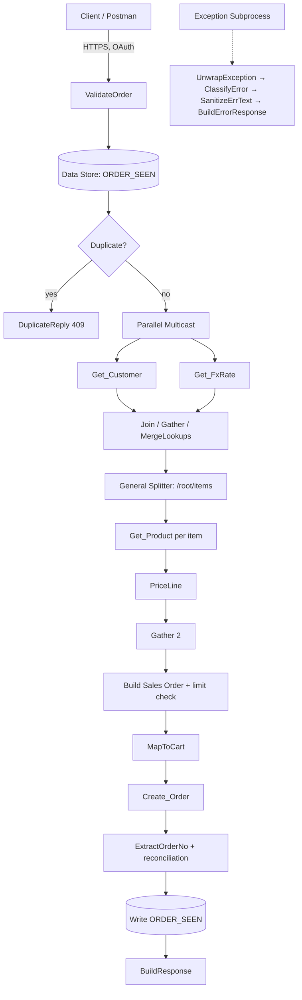

### Design decisions

- **Fail early.** All input checks run before the first outbound call, so invalid requests cost nothing and never touch the backends.
- **Money as `BigDecimal`.** Line and order amounts are rounded half-up to two decimals; the USD total is reconciled against the backend.
- **One error contract.** A single exception subprocess turns every failure into the same JSON shape and sanitizes the text so no URLs or internals leak.
- **Externalized configuration.** Limits and endpoints are parameters, not hard-coded (see [Configuration](#configuration)).
- **Traceability.** A correlation ID and the business key are written to the MPL as custom headers.

## API contract

`POST /http/orders/v1/salesorders` — `Content-Type: application/json`, OAuth 2.0 client credentials (a call without authorization is rejected by the runtime with `401`).

**Request**

```json
{
  "externalOrderId": "WEB-1794397403-911",
  "customerId": 1,
  "orderDate": "2026-11-11",
  "currency": "EUR",
  "items": [
    { "productId": 1,   "quantity": 1 },
    { "productId": 144, "quantity": 1 }
  ]
}
```

**Success (201)**

```json
{
  "salesOrder": "209",
  "correlationId": "b2b5036a-2835-42f9-850d-97e54b662a38",
  "currency": "EUR",
  "orderNetAmount": "49.03",
  "fxRate": "0.89174",
  "fxRateDate": "2026-11-10"
}
```

Check by hand: 9.99 USD + 44.99 USD = 54.98 USD; × 0.89174 = **49.03 EUR** (line amounts 8.91 + 40.12).

**Error**

```json
{
  "correlationId": "…",
  "integration": "O2C_ORDER_FACADE",
  "errorCategory": "BUSINESS",
  "errorCode": "DUPLICATE_ORDER",
  "message": "Order WEB-DUP-… was already processed",
  "retryable": false
}
```

| Category | Meaning | HTTP | `retryable` |
|---|---|---|---|
| `VALIDATION` | Input is invalid; nothing was sent to a backend | 400 / 422 | false |
| `BUSINESS` | Rule violated (duplicate, over limit, unknown product, insufficient stock) | 404 / 409 | false |
| `TECHNICAL` | Backend or network problem | 5xx | **true** |

## Configuration

Externalized parameters (Configure view):

| Parameter | Default | Purpose |
|---|---|---|
| `MAX_ORDER_VALUE` | `5000` | Order-value limit in the order currency |
| `DUMMYJSON_BASE` | `https://dummyjson.com` | Customer and product lookups |
| `FX_BASE` | `https://api.frankfurter.dev` | Exchange rates |
| `ORDERS_URL` | DummyJSON `…/carts/add` | Order creation (changed to a 500 URL for test T7) |

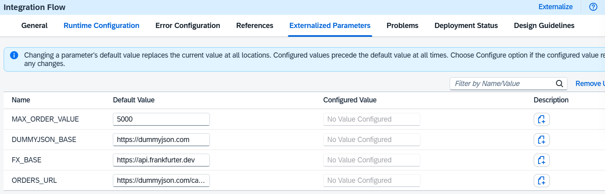

## Screenshots

### Integration flow

**Part A — validation and duplicate check**

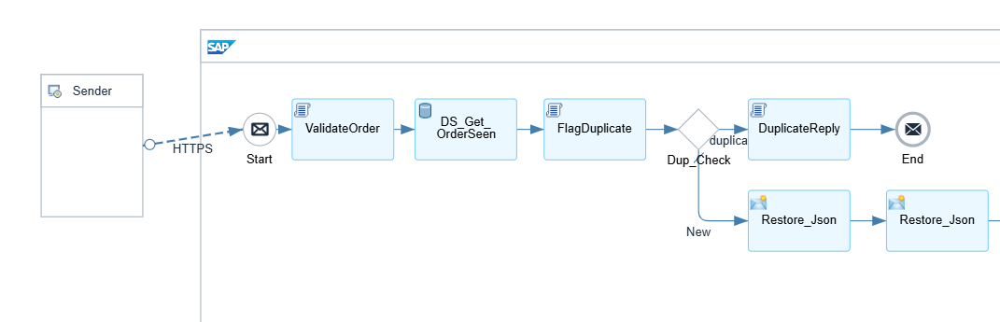

**Part B — parallel customer and FX lookups**

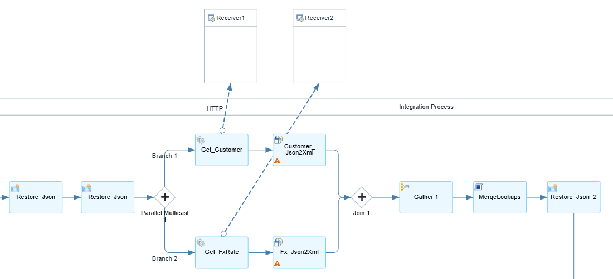

**Part C — item splitting, order creation, response, and the exception subprocess**

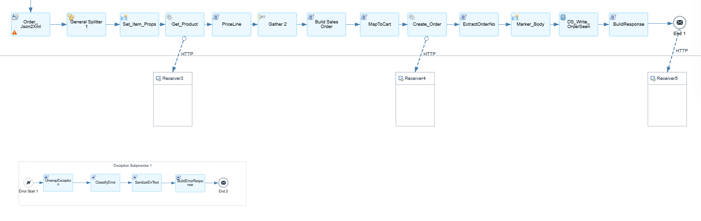

### Deployment and setup

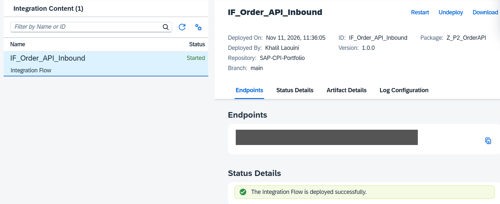

The runtime endpoint is redacted. The BTP service key used for OAuth (all values redacted):

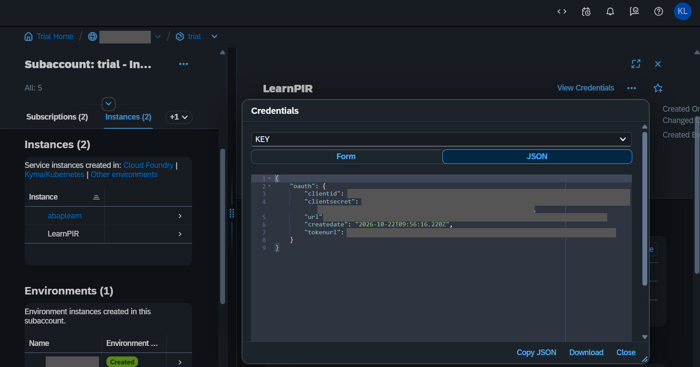

### Successful run (T1)

The Message Processing Log shows the custom headers set by the flow, including `Reconcile = MATCH` — my own USD total equals the backend's total.

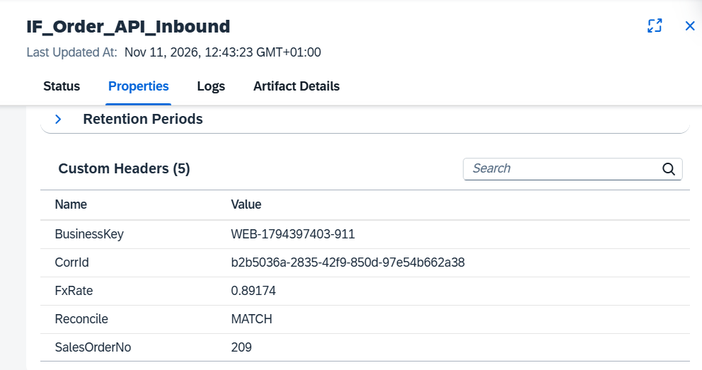

The trace after the splitter's gather step: one priced `<line>` per item, wrapped in `multimap:Messages`.

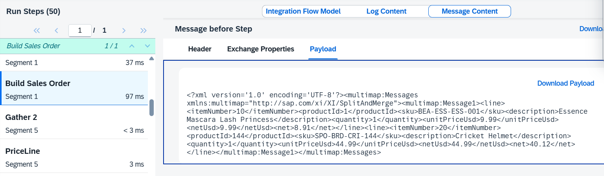

### Error handling

| Scenario | Evidence |
|---|---|
| **T2** — `customerId` missing → `400 VALIDATION` | 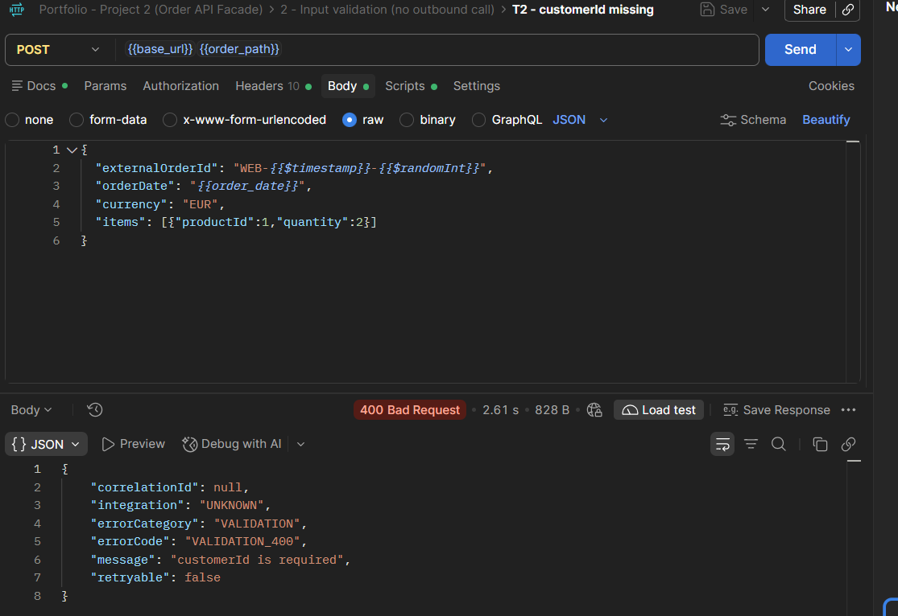 |
| **T5** — no authorization → `401` from the runtime | 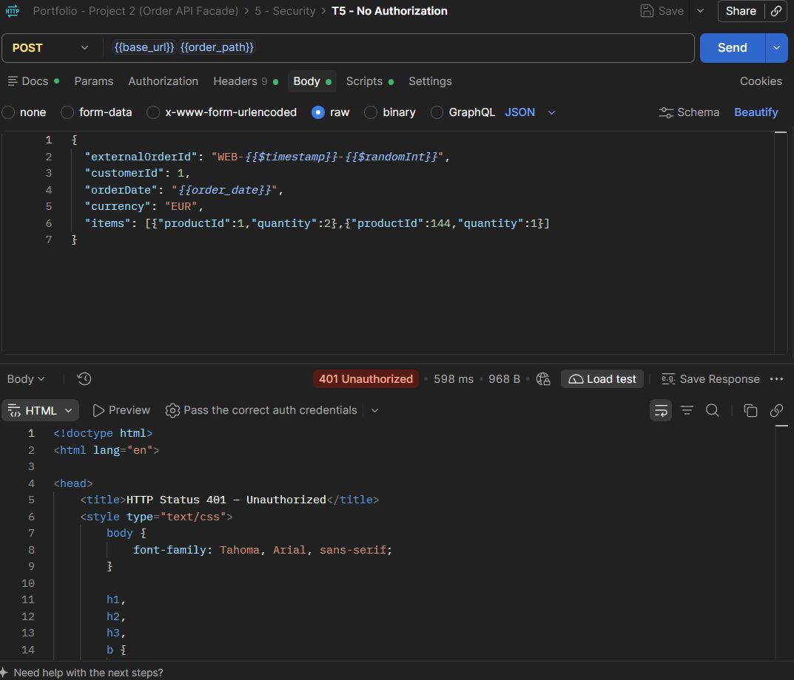 |
| **T7** — backend returns 500 → `TECHNICAL`, `retryable: true` | 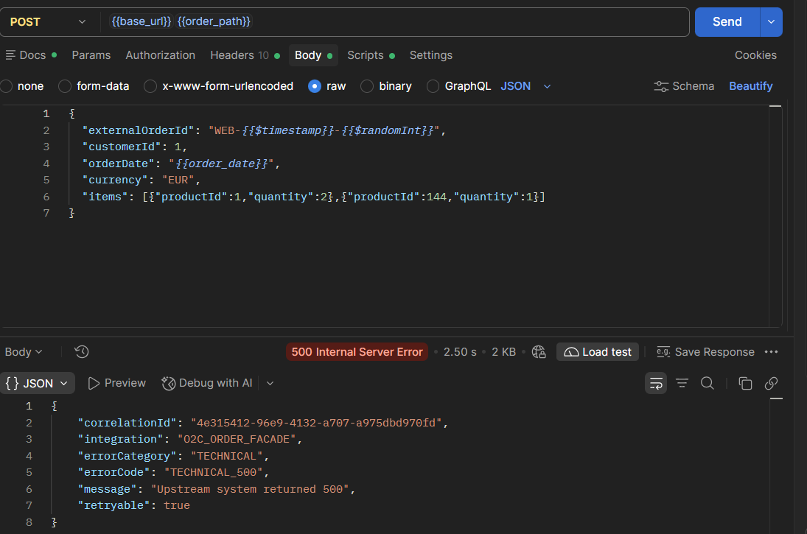 |
| **T10** — order value above the limit → `409 BUSINESS` | 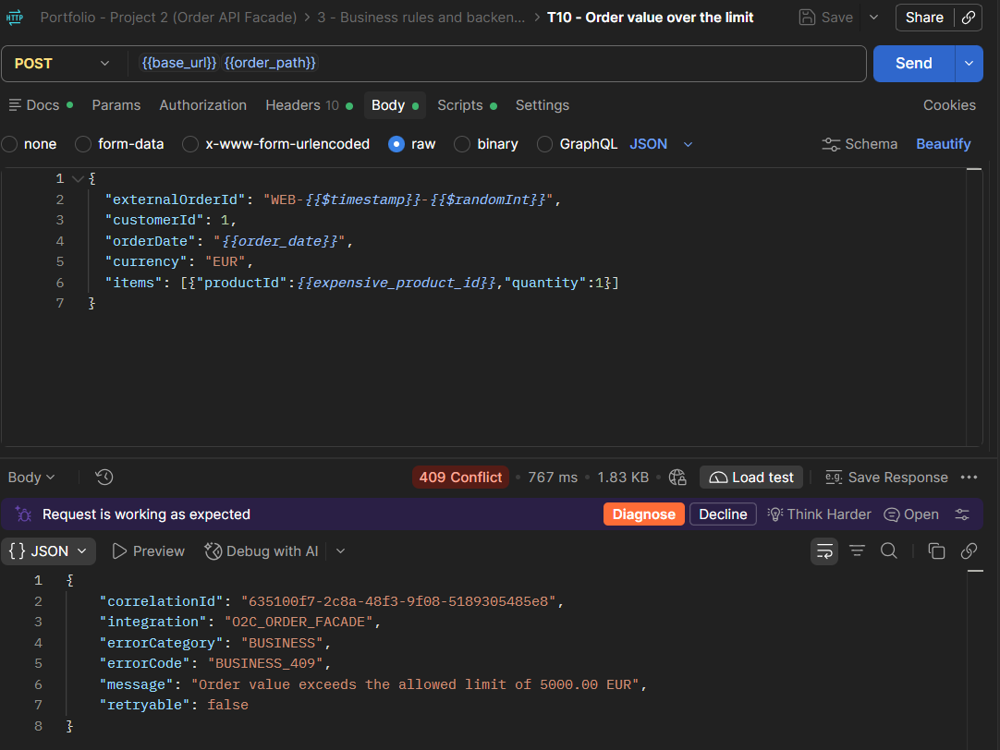 |
| **T13** — same order sent twice → `409 DUPLICATE_ORDER` | 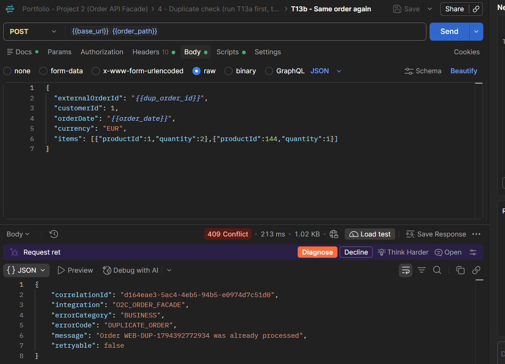 |

The duplicate check is backed by the `ORDER_SEEN` Data Store:

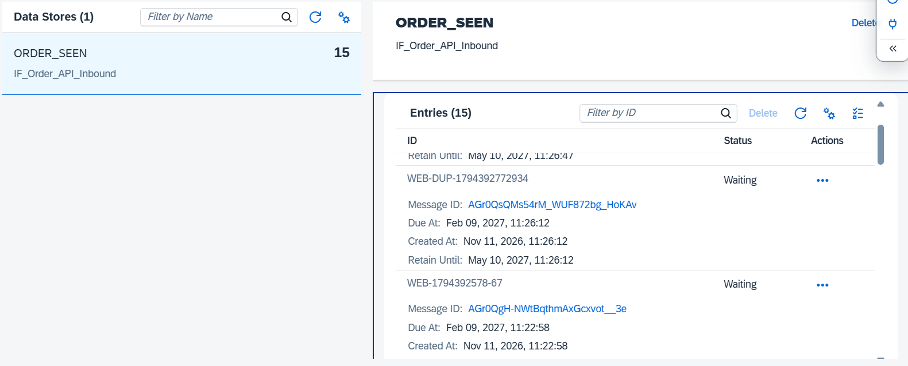

## Results

| Test | Scenario | Result |
|---|---|---|
| T1 | Valid order, two items, EUR | Order created, `Reconcile=MATCH`, net amount matches hand calculation |
| T2 | `customerId` missing | `400 VALIDATION_400`, no outbound call |
| T5 | No authorization | `401` from the runtime |
| T7 | Backend 500 | `TECHNICAL_500`, `retryable: true`, no URL in the response |
| T10 | Order over the limit | `409`, "exceeds the allowed limit of 5000.00 EUR" |
| T13 | Duplicate order | `409 DUPLICATE_ORDER`, no backend call |

The Postman collection in `postman/` contains the full set of scenarios, including further validation, stock and currency cases. T6 (token without the required role) is **not demonstrated**.

## Security

- Runtime-level OAuth 2.0 (client credentials); unauthenticated calls never reach the flow.
- Input whitelist: currency list, digits-only product and customer IDs (they end up in URLs), safe `externalOrderId` and correlation header (prevents URL and header injection).
- Error text is sanitized: no backend URLs or stack traces in responses.
- No credentials in the repository; screenshots are redacted.

## Limitations

- The order is simulated, so there is no real persistence and the order number repeats.
- Product prices and stock are sample data and can change at the source, so tests compare against calculations rather than fixed numbers.
- Frankfurter publishes on working days; weekend calls return the last published rate (see `fxRateDate`).
- Built and tested on an SAP BTP trial tenant.

## Author

Khalil Laouini — part of the *SAP-CPI-Portfolio* repository.
