# SAP Cloud Integration: Scheduled Product Extract & Converter Lab

> **One iFlow, two integration processes.** A timer-driven **OData → CSV → Email** extract with error classification and alerting, plus an **HTTPS Converter Lab** that routes payloads between CSV, XML and JSON.


---

## Table of contents

1. [Overview](#1-overview)
2. [Architecture](#2-architecture)
3. [Flow 1: Scheduled Product Extract](#3-flow-1-scheduled-product-extract)
4. [Flow 2: Converter Lab](#4-flow-2-converter-lab)
5. [Error handling and alerting](#5-error-handling-and-alerting)
6. [Configuration and security](#6-configuration-and-security)
7. [Repository structure](#7-repository-structure)
8. [How to deploy and run](#8-how-to-deploy-and-run)
9. [Testing](#9-testing)
10. [Evidence gallery](#10-evidence-gallery)
11. [Design decisions](#11-design-decisions)
12. [Known limitations and lessons learned](#12-known-limitations-and-lessons-learned)
13. [Scope and honest claims](#13-scope-and-honest-claims)
14. [Skills demonstrated](#14-skills-demonstrated)

---

## 1. Overview

This project was built on an **SAP Integration Suite trial tenant** (Cloud Integration) as a hands-on portfolio piece. Originally two separate iFlows, it is now **merged into a single artifact**, `IF_Product_Extract_Daily`, that contains two independent integration processes:

| # | Process | Trigger | What it does |
|---|---------|---------|--------------|
| 1 | **Scheduled Product Extract** | Timer | Reads products from the public Northwind OData V2 service, keeps active products, flattens and cleans them with XSLT, counts rows, converts to CSV and emails the file. Failures are classified and an alert mail is sent to an admin. |
| 2 | **Converter Lab** | HTTPS `POST /lab/convert` | A Router on the `mode` header sends the payload to a CSV→XML, XML→JSON or JSON→XML converter. Unknown modes get an HTTP 400. |

**Profile:** *Full*, meaning a real public OData source (Northwind) and a real SMTP delivery (Gmail SMTP). No mocks are used.

### What it demonstrates

- OData V2 receiver adapter (Query/GET, `$select`, `$top`)
- XSLT mapping used for filtering and renaming
- Groovy (script API **v2**) for row counting, custom MPL headers and error classification
- XML→CSV, CSV→XML, XML→JSON and JSON→XML converters
- Router with Non-XML conditions and a default route
- Exception subprocess with Error End and an alert mail that carries the error class
- Externalized parameters, credential alias in Security Material, OAuth2 client credentials with CSRF handling in Postman

---

## 2. Architecture

### High level

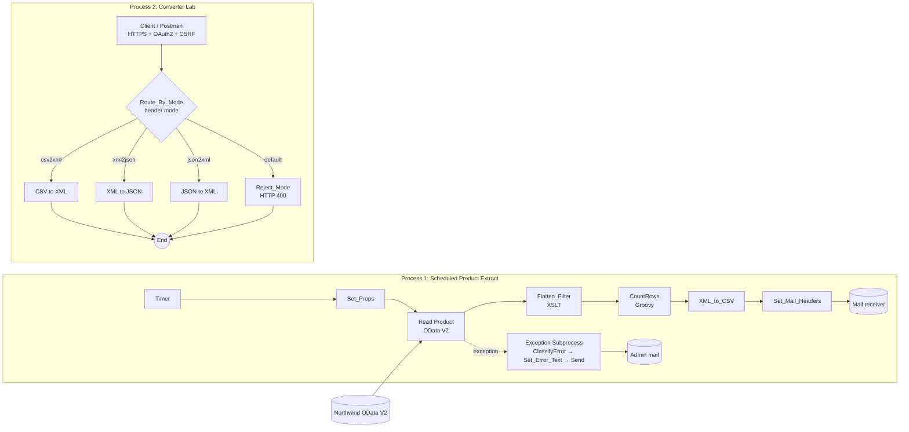

### Editor screenshots

**Process 1, scheduled extract with exception subprocess**
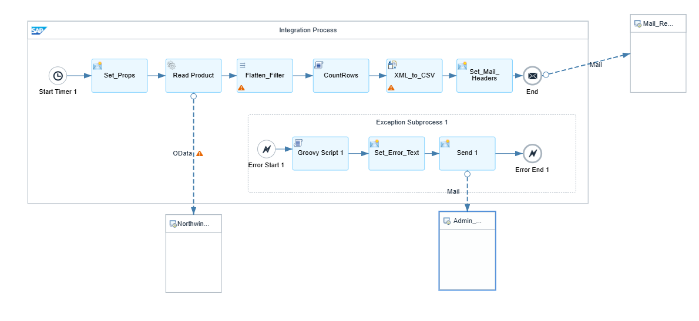

**Process 2, Converter Lab**
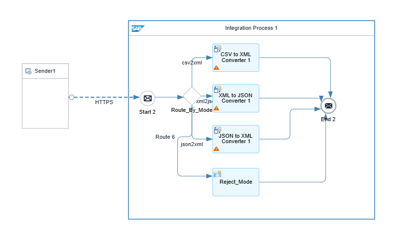

---

## 3. Flow 1: Scheduled Product Extract

| Step | Type | Purpose |
|------|------|---------|
| **Start Timer 1** | Timer | Starts the flow. Currently *Run Once* (runs on every deploy). A daily schedule at 06:00 is the production setting (see [limitations](#12-known-limitations-and-lessons-learned)). |
| **Set_Props** | Content Modifier | Creates exchange properties `RunDate` (`${date:now:yyyy-MM-dd}`) and `AttachName` (`products_${property.RunDate}.csv`). Also sets the `SAP_ApplicationID`, `SAP_MessageType`, `SAP_Sender` and `SAP_Receiver` headers so runs are searchable in the monitor. |
| **Read Product** | OData V2 receiver (Request-Reply) | `Query (GET)` on `Products` with `$select=ProductID,ProductName,UnitPrice,UnitsInStock,Discontinued&$top=100`, Atom content type, no batch. |
| **Flatten_Filter** | XSLT mapping | Keeps only `Discontinued='false'` products with a non-empty ID and a price ≥ 0. Renames fields (`ProductName` → `Name`, `UnitPrice` → `Price`, `UnitsInStock` → `Stock`). Prices use `format-number(…,'0.00')`, never locale formatting. |
| **CountRows** | Groovy (v2) | Counts `<Row>` elements, stores `RowCount` as a property, and writes `RowCount` and `CorrId` as **custom MPL headers**. |
| **XML_to_CSV** | XML to CSV converter | Node path `/Rows/Row`, separator `,`, UTF-8, header row from field names. |
| **Set_Mail_Headers** | Content Modifier | Sets `Subject_Text` = `Product extract ${property.RunDate} (${property.RowCount} rows)`. |
| **End → Mail receiver** | Mail adapter (Gmail SMTP) | Sends the CSV as an attachment named `${property.AttachName}` (`text/csv`, source Body). |

### Data contract

`Flatten_Filter.xsl` turns the OData `<Products>` feed into:

```xml
<Rows>
  <Row><ProductID>1</ProductID><Name>Chai</Name><Price>18.00</Price><Stock>39</Stock></Row>
  …
</Rows>
```

and the CSV delivered by mail has the shape:

```csv
ProductID,Name,Price,Stock
1,Chai,18.00,39
2,"Chang, large",19.00,17
```

A product name containing a comma is expected to be quoted by the converter. See test **T5** in [Testing](#9-testing).

### OData adapter configuration

| Connection | Processing |
|---|---|
| 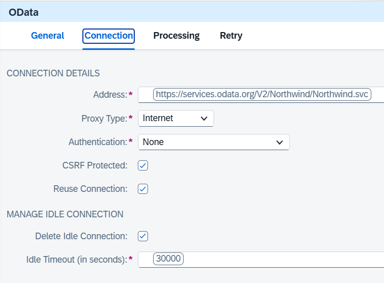 | 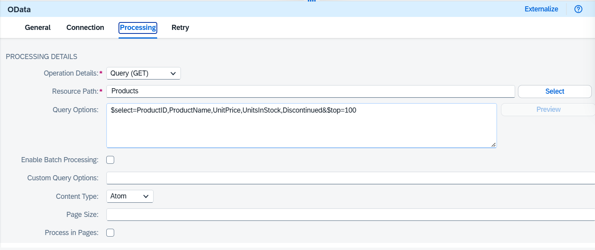 |

---

## 4. Flow 2: Converter Lab

An HTTPS sender on `/lab/convert` (role `ESBMessaging.send`) feeds a **Router** called `Route_By_Mode`.

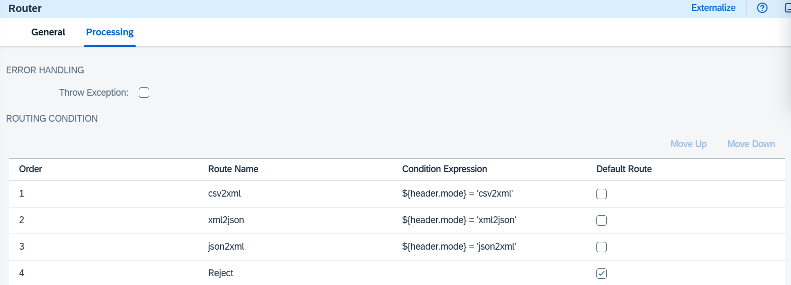

| Route | Condition (Non-XML) | Target |
|-------|---------------------|--------|
| `csv2xml` | `${header.mode} = 'csv2xml'` | CSV to XML converter (schema `Rows.xsd`, target element `/Rows/Row`, separator `,`, first line excluded as header) |
| `xml2json` | `${header.mode} = 'xml2json'` | XML to JSON converter (no namespace mapping, root element kept) |
| `json2xml` | `${header.mode} = 'json2xml'` | JSON to XML converter (no namespace mapping; root element `root`) |
| *default* | n/a | **Reject_Mode**: sets `CamelHttpResponseCode = 400` and the body to `mode must be csv2xml, xml2json or json2xml` |

All four branches end in the same **End Message** event.

### Request examples

```http
POST {{base_url}}/lab/convert
mode: csv2xml
Content-Type: text/plain

ProductID,Name,Price,Stock
1,Chai,18.00,39
2,"Chang, large",19.00,17
```

| mode | Content-Type | Body | Expected response |
|---|---|---|---|
| `csv2xml` | `text/plain` | CSV above | `<Rows><Row><ProductID>1</ProductID>…` two rows, comma in name intact |
| `xml2json` | `application/xml` | `<Rows>` with 2 `<Row>` | JSON where `Row` is an **array** |
| `xml2json` | `application/xml` | `<Rows>` with 1 `<Row>` | `Row` is an **object**, not an array (known converter behaviour) |
| `json2xml` | `application/json` | `{"items":[{"id":1},{"id":2}]}` | `<root><items><id>1</id></items><items><id>2</id></items></root>` |
| `foo` | any | any | **HTTP 400**, `mode must be csv2xml, xml2json or json2xml` |

Sample payloads are in [`samples/`](samples).

---

## 5. Error handling and alerting

Flow 1 has an **Exception Subprocess** (Error Start → `ClassifyError` Groovy → `Set_Error_Text` → `Send` → **Error End**). The subprocess ends in an *Error End*, so a failed run is shown as **Failed** in the monitor.

`ClassifyError.groovy` sets four properties from the caught exception:

| Property | Meaning |
|---|---|
| `ErrCategory` | `VALIDATION`, `SECURITY`, `BUSINESS`, `MAPPING` or `TECHNICAL` |
| `ErrStatus` | HTTP-style status code |
| `ErrRetryable` | `true` or `false` |
| `ErrText` | Message text. For `TECHNICAL` and `SECURITY` the text is deliberately generic, so internals are not leaked into mail. |

The alert mail has the subject `ALERT product extract ${property.ErrCategory}` and the body `Product extract failed (${property.ErrCategory}, retryable=${property.ErrRetryable}): ${property.ErrText}`. `ErrCategory` and `ErrRetryable` are also added as custom MPL headers.

---

## 6. Configuration and security

### Externalized parameters

| Parameter | Used by | Example (placeholder) |
|---|---|---|
| `OData_Service_URL` | OData receiver | `https://services.odata.org/V2/Northwind/Northwind.svc` |
| `MAIL_FROM` | Mail receiver | `integration@example.com` |
| `MAIL_TO` | Mail receiver | `you@example.com` |
| `TIMEOUT` | OData receiver idle timeout | `30000` |

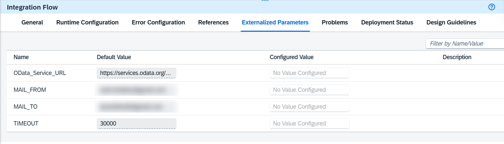

*(Real addresses are blurred in this screenshot. In the repo's exported iFlow, the default values are placeholders.)*

> ⚠️ **Never commit real values.** The exported `parameters.prop` contains the values you configured, so it is listed in `.gitignore`. Replace real addresses with placeholders before exporting for the repo.

### Security material

| Alias | Type | Purpose |
|---|---|---|
| `Gmail_Cred` | User Credentials | SMTP login (Gmail **app password**, not the account password) |

No passwords, tokens or service keys are stored in this repository. In the Postman collection, `client_id` and `client_secret` are marked *secret* and the variable values are empty.

### Inbound security (Converter Lab)

- Sender authentication: **Role-based**, role `ESBMessaging.send`
- OAuth2 *client credentials* against the tenant's XSUAA token endpoint
- **CSRF Protected is on**, so the Postman pre-request script fetches an OAuth token and then an `x-csrf-token` before every call

---

## 7. Repository structure

```
.
├── README.md
├── docs/images/                 # screenshots used in this README
├── src/
│   ├── mapping/Flatten_Filter.xsl
│   ├── script/CountRows.groovy
│   ├── script/ClassifyError.groovy
│   └── xsd/Rows.xsd
├── postman/
│   └── IF_Converter_Lab.postman_collection.json
├── samples/                     # sample inputs and expected outputs
├── architecture/                # capability check (see below)
└── iflow/                       # exported iFlow ZIP (re-export with placeholders only)
```

---

## 8. How to deploy and run

1. **Package:** create a package in Integration Suite (*Design → Integrations and APIs → Create*).
2. **Credentials:** *Monitor → Manage Security → Security Material → Create → User Credentials*, alias `Gmail_Cred`, user = Gmail address, password = Gmail **app password**.
3. **Import the iFlow:** package → *Artifacts → Add → Integration Flow → Upload*, choose the exported ZIP.
4. **Configure:** open the iFlow → *Configure* → set `OData_Service_URL`, `MAIL_FROM`, `MAIL_TO`.
5. **Save and Deploy.** The timer is *Run Once*, so the extract runs immediately after deployment.
6. **Check the run:** *Monitor → Message Processing*. The status should be **Completed**, and the mail should arrive with the CSV attached.
7. **Converter Lab:** copy the endpoint from *Manage Integration Content* (`<RUNTIME>/http/lab/convert`), import the Postman collection, fill `base_url`, `token_url`, `client_id`, `client_secret` and run requests C1 to C5.

> **Heads-up:** both processes live in one artifact. Redeploying it for any reason (for example a converter tweak) restarts the *Run Once* timer and sends another extract mail.

---

## 9. Testing

### Flow 1

| ID | Scenario | Expected | Result | Evidence |
|----|----------|----------|--------|----------|
| T1 | Run once, valid config | Completed, CSV mail, row count in subject | ✅ **Completed** (2.7 s), mail `Product extract 2026-11-09 (69 rows)` with `products_2026-11-09.csv` (2.1 KB) | [MPL](docs/images/mpl-success.png), [mail](docs/images/mail-success.png), [custom headers](docs/images/mpl-custom-headers.png): `RowCount = 69`, `CorrId = 2026-11-09` |
| T2 | OData resource path or address wrong | Failed, alert mail with error category | ✅ **Failed** with `OsciException: Not Found : 404`. Alert mail `ALERT product extract TECHNICAL`, `retryable=true` | [list](docs/images/mpl-failure-list.png), [detail](docs/images/mpl-failure-detail.png), [mail](docs/images/mail-alert.png) |
| T3 | Wrong SMTP password | Failed at Mail step, category `SECURITY` or `TECHNICAL`, alert cannot be sent either | ⬜ not yet recorded | n/a |
| T4 | Source returns no active products | Header-only CSV, `RowCount` 0, decision documented | ⬜ not yet recorded | n/a |
| T5 | Name with comma or umlaut | Quoted or escaped, UTF-8 intact | ✅ **Umlauts and ß intact** (`Gustaf's Knäckebröd`, `Tunnbröd`, `NuNuCa Nuß-Nougat`). The Northwind names contain no commas, so comma quoting is covered separately by **C1** on the CSV→XML side | [CSV attachment](docs/images/csv-attachment.png) |

> **Filter evidence:** the CSV [attachment](docs/images/csv-attachment.png) skips product IDs 5, 9, 17, 24, 28 and 29, which are discontinued Northwind products, and has a header row `ProductID,Name,Price,Stock`. (The spreadsheet preview shows `18` for `18.00`; that is the viewer's number formatting, not the file.)

### Converter Lab (Postman, requests C1 to C5)

| ID | Mode | Expected | Result | Evidence |
|----|------|----------|--------|----------|
| C1 | `csv2xml` | Two `<Row>` elements, `Chang, large` intact | ✅ **200 OK**, 2 rows, `Chang, large` intact, `18.00` / `19.00` kept. 3/3 assertions pass | [C1](docs/images/postman-c1.png) |
| C2 | `xml2json` (2 rows) | `Row` is an array | ✅ **200 OK**, `"Row": [ … ]`. 2/2 assertions pass | [C2](docs/images/postman-c2.png) |
| C3 | `xml2json` (1 row) | `Row` is an object | ✅ **200 OK**, `"Row": { … }` (known single-element behaviour). 2/2 assertions pass | [C3](docs/images/postman-c3.png) |
| C4 | `json2xml` | `<root><items>…</items><items>…</items></root>` | ✅ **200 OK**, `<root>` with two `<items>` | [C4](docs/images/postman-c4.png) |
| C5 | `foo` | HTTP 400 with the Reject_Mode text | ✅ **400 Bad Request**, `mode must be csv2xml, xml2json or json2xml (got: [foo])` | [C5](docs/images/postman-c5.png) |

The Postman collection contains one request per test plus automatic assertions (`pm.test`) for each expected result.


---

## 10. Evidence gallery

| Success run | Failure run |
|---|---|
| 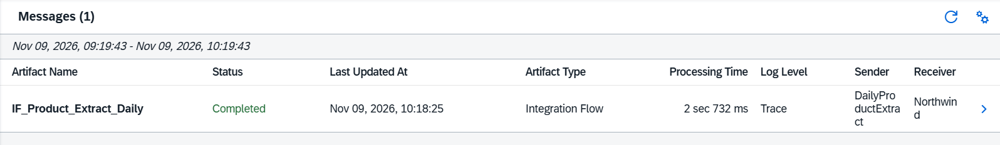 | 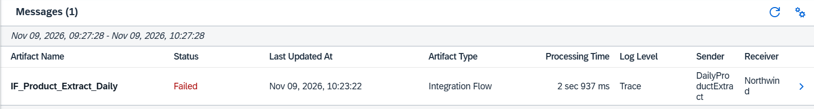 |
| 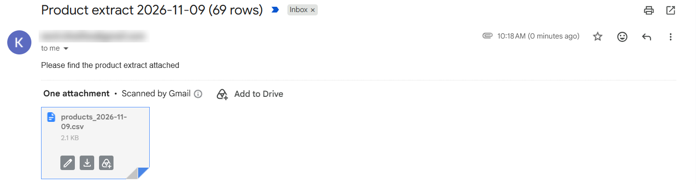 | 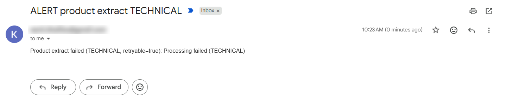 |

**Failure detail**

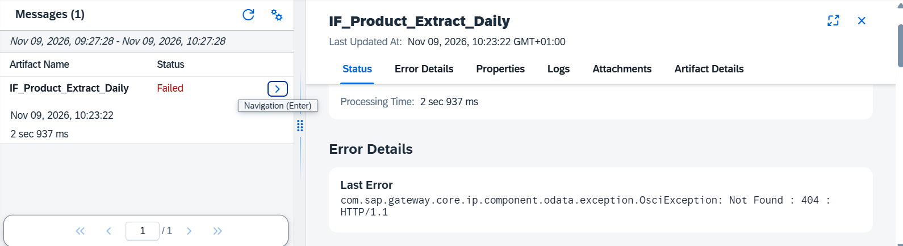

**Custom MPL headers (`RowCount`, `CorrId`)**

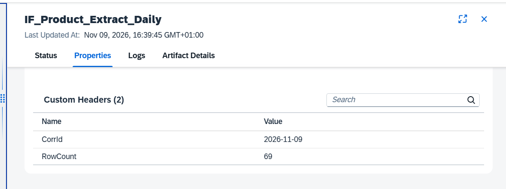

**CSV attachment as received**

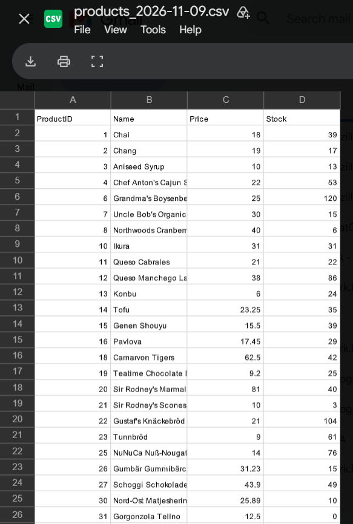

**Converter Lab, Postman results**

| C1 CSV→XML | C2 XML→JSON (2 rows) |
|---|---|
| 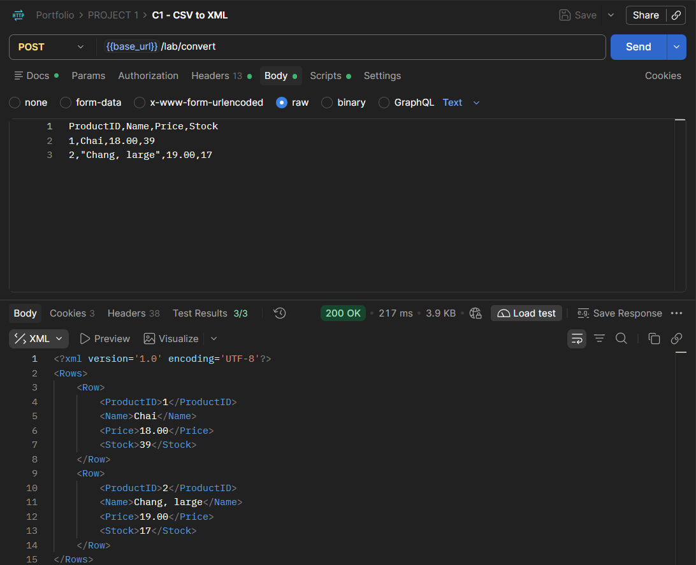 | 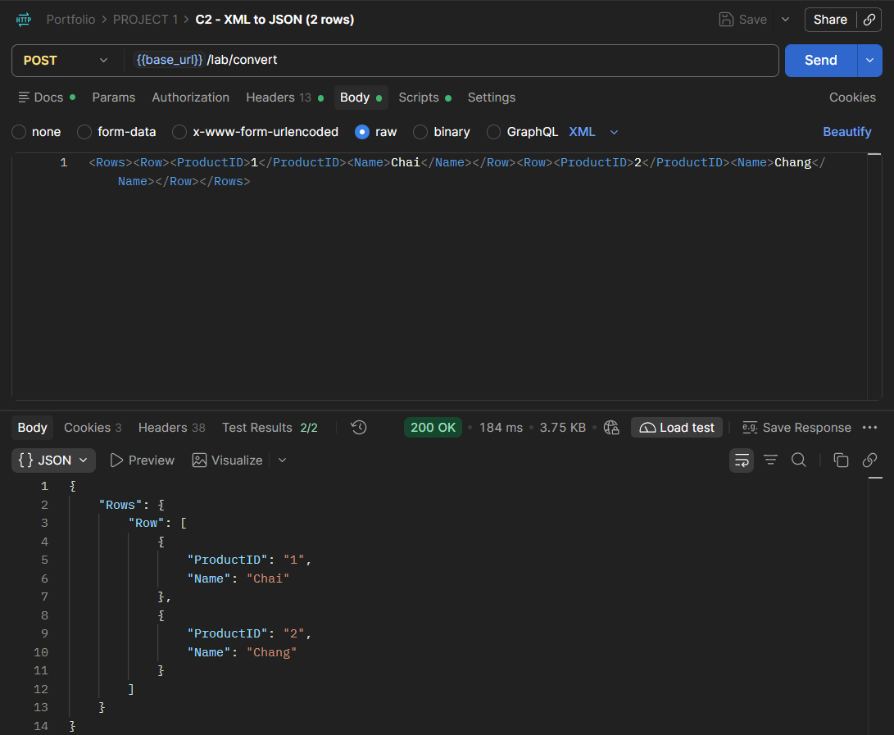 |

| C3 XML→JSON (1 row) | C4 JSON→XML |
|---|---|
| 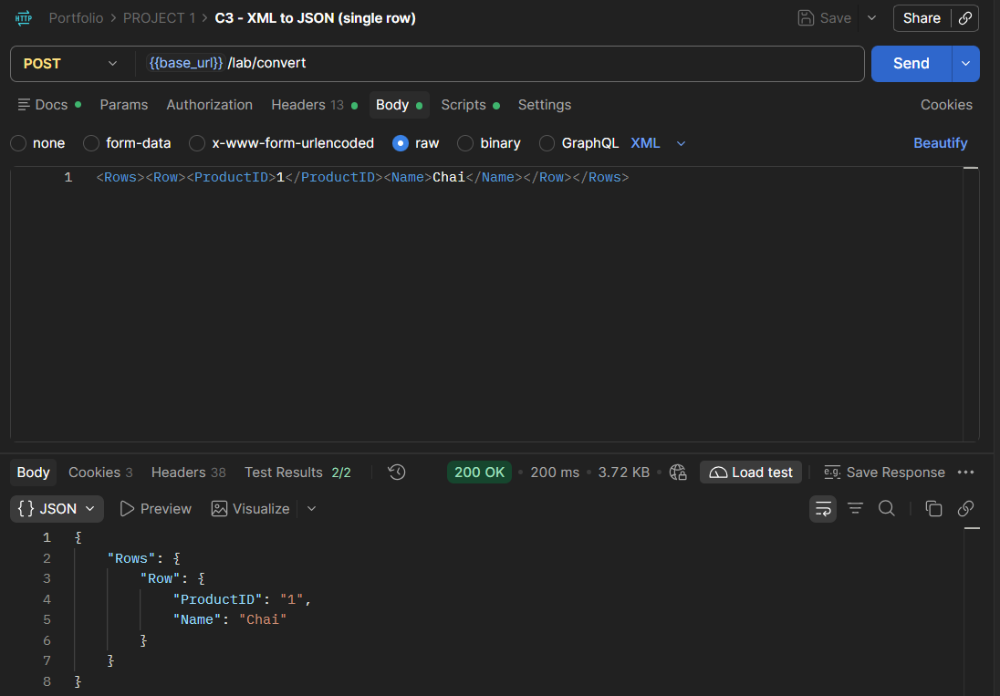 | 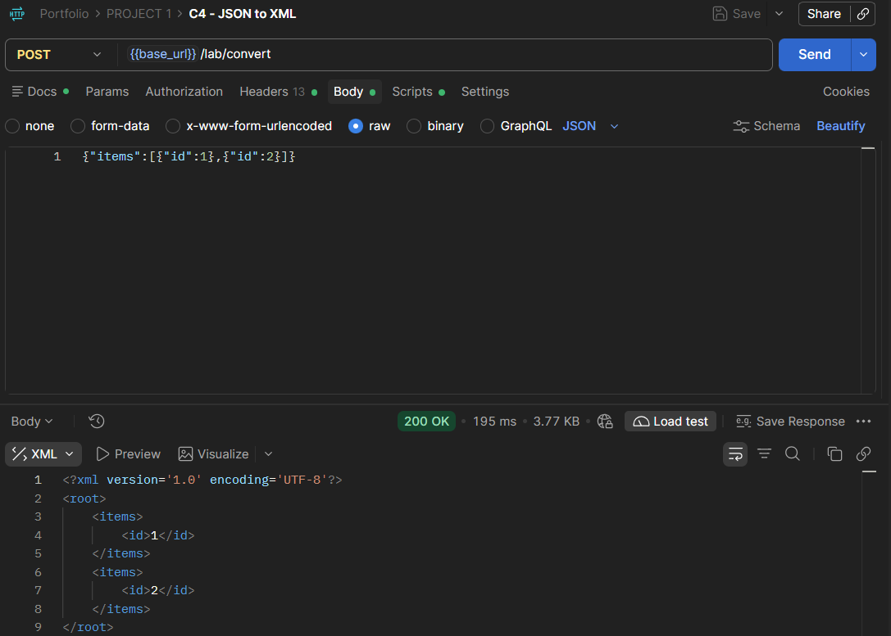 |

**C5 bad mode → 400**

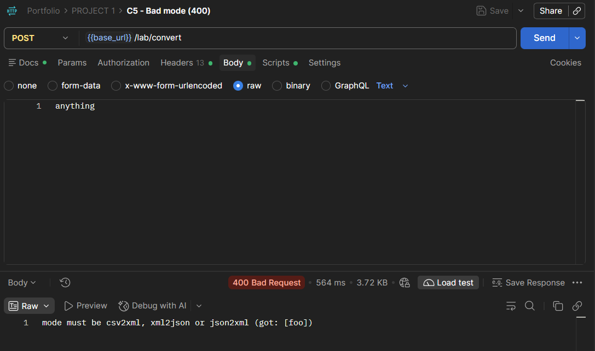

The *Sender* column shows `DailyProductExtract` and the *Receiver* column `Northwind`: these come from the `SAP_Sender` and `SAP_Receiver` headers set in `Set_Props`.

---

## 11. Design decisions

- **XSLT instead of graphical mapping:** the job is a filter plus a rename. A 15-line stylesheet is smaller and easier to review than a graphical mapping. Graphical mapping would be preferable for many-to-many structures or when non-developers must maintain it.
- **Property vs header:** `RunDate`, `AttachName` and `RowCount` are *exchange properties* (they live for the whole exchange). `Subject_Text` is a *header*, because it travels to the Mail receiver.
- **Groovy v2 API:** scripts import `com.sap.it.script.v2.api.Message`, which is current on the Groovy 4 runtime.
- **Generic error text for `TECHNICAL` and `SECURITY`:** details stay in the monitor, not in mail.
- **Error End instead of Message End:** a failed run must show as *Failed* in the monitor.
- **Gmail SMTP with app password instead of Mailtrap:** real delivery, no sandbox.
- **Searchable runs:** `SAP_*` headers and custom MPL headers (`RowCount`, `CorrId`, `ErrCategory`, `ErrRetryable`).
- **Merged artifact:** one deployable unit instead of two. The trade-off is that the two processes share a deploy lifecycle (see below).

---

## 12. Known limitations and lessons learned

| Topic | Detail |
|---|---|
| **404 from the OData adapter is classified `TECHNICAL`** | `ClassifyError` checks for `HttpOperationFailedException`, but the OData adapter throws `com.sap.gateway.core.ip.component.odata.exception.OsciException`. It falls through to the default (`TECHNICAL`, `retryable=true`), and the mail shows the generic text. A 404 would normally be `BUSINESS`, not retryable. An extra branch for `OsciException` that reads the status from the message would fix it. |
| **Timer is *Run Once*** | Every deployment triggers a run and a mail. For production, switch to *Schedule on Day → Every Day → 06:00* with your time zone. |
| **Shared deploy lifecycle** | Changing the Converter Lab redeploys the extract flow too. |
| **Single-element XML→JSON** | The converter emits an object, not a one-element array, when the XML has only one `<Row>`. Consumers must handle both shapes. A Groovy step or schema-aware mapping can force an array. |
| **CSRF handling for API clients** | CSRF protection is on for the HTTPS sender, so clients must fetch a token first (done in the Postman pre-request script). Untick *CSRF Protected* if you do not want this. |
| **Router sends everything to Reject (`got: []`)** | If the `mode` header is not visible to the Router, add `mode` to *Runtime Configuration → Allowed Header(s)* and redeploy. Header names are exact, so check for a trailing space. |
| **Public demo source** | Northwind is a public demo service, not S/4HANA. |
| **Mail is the only sink** | There is no retry or dead-letter store for failed mails. |

---

## 13. Scope and honest claims

**What this project is:** a built and tested scheduled OData-to-CSV integration and a converter lab on an SAP Integration Suite trial, using XSLT, Router, four converters, SMTP delivery, error classification and alerting.

**What it is not:** a production system. The source is a public demo service, the mail is a lab output, and there are no SLAs or business-time-saved claims.

---

## 14. Skills demonstrated

`SAP Integration Suite` · `Cloud Integration iFlow design` · `OData V2` · `XSLT 1.0` · `Groovy (script API v2)` · `Router / conditions` · `XML/CSV/JSON conversion` · `Exception subprocesses` · `Monitoring and MPL custom headers` · `Externalized parameters` · `Security material` · `OAuth2 client credentials + CSRF` · `Postman automation and tests`

---

### Author

*Your name* · [LinkedIn](https://www.linkedin.com/) · [GitHub](https://github.com/)
